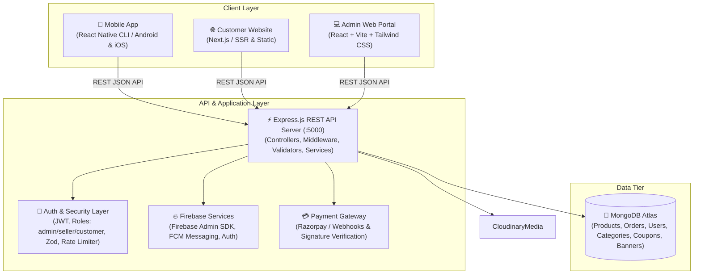

# Tech Crate — Complete Full-Stack Architecture Documentation

This document outlines the multi-application architecture of **Tech Crate**, connecting the Customer Mobile App, Customer Next.js Website, React/Vite Admin Panel, and the Node.js/Express/MongoDB/Firebase Backend API.

---

## 1. System Overview & Architecture Topology



---

## 2. Application Modules Breakdown

### A. Customer Mobile Application (`/mobile`)
- **Framework**: React Native CLI (bare React Native, JavaScript / JSX only).
- **Navigation**: React Navigation (`@react-navigation/native`, `@react-navigation/stack`, `@react-navigation/bottom-tabs`).
- **State Management**: Zustand stores (`authStore`, `productStore`, `cartStore`, `wishlistStore`).
- **API Client**: Axios with automatic JWT Bearer token attachment and token refresh.
- **Backend Host Resolution**:
  - Android Emulator: `http://10.0.2.2:5000/api`
  - iOS Simulator & Physical Device (ADB reverse): `http://localhost:5000/api`
  - Configurable via `.env` (`API_BASE_URL`).

### B. Customer Website (`/website`)
- **Framework**: Next.js (React, JavaScript / JSX only).
- **Styling**: Tailwind CSS with custom TechCrate electronics maker theme.
- **Pages & Routes**:
  - `/` — Homepage featuring Hero, Categories, Featured Components, DIY Project Kits, Value Props.
  - `/products` — Product Catalog with category filtering, search, sorting, and pagination.
  - `/products/[id]` — Detailed hardware component specifications, dynamic image gallery, stock badge, add to cart.
  - `/projects` — DIY project kits, schematics, and bill-of-materials.
  - `/cart` & `/checkout` — Cart management, coupon application, address input, UPI order placement.
  - `/orders` & `/account` — Customer account overview, order tracking, address book.
  - `/ai-assistant` — Interactive AI component selector & circuit advisor.
- **Port**: `http://localhost:3000`.

### C. Backend API Server (`/backend`)
- **Runtime & Framework**: Node.js, Express.js.
- **Database**: MongoDB (via Mongoose ODM).
- **Authentication**: JWT authentication with access tokens and refresh tokens. Role-based access control (`customer`, `seller`, `admin`).
- **Security Middleware**:
  - Helmet for security HTTP headers.
  - Express-Mongo-Sanitize for NoSQL injection prevention.
  - Strict CORS policy supporting website (`:3000`), admin (`:5173`), mobile emulators (`10.0.2.2:5000`), and production domains.
  - Route-level rate limiting (`apiLimiter`, `authLimiter`).
  - Zod validation for incoming request payloads.
- **Port**: `http://localhost:5000`.

### D. Admin Control Panel (`/admin`)
- **Framework**: React 18, Vite.
- **Port**: `http://localhost:5173` (isolated from Next.js website port 3000).
- **Features**:
  - Overview Dashboard with live sales, orders, and stock telemetry.
  - Product Management: Creation, modification, soft-delete/archival, multi-image upload, specifications.
  - Category & Subcategory Management.
  - Order Processing: Status progression (Pending → Processing → Shipped → Delivered / Cancelled).
  - Coupon & Banner management.
  - Push Notification dispatching via Firebase Cloud Messaging.

---

## 3. Data Flow & Single Source of Truth

All business data (products, prices, discounts, inventory, orders, customer records) originate and persist exclusively in **MongoDB** through the **Express API**:

```
[Admin / Seller Action] 
       │
       ▼
[Express Controller & Zod Validator] 
       │ (Validates schema, checks roles, sanitizes inputs)
       ▼
[Mongoose ODM -> MongoDB Atlas] 
       │ (Persists document with timestamps, indexes, soft-delete flags)
       ▼
[JSON REST Response] 
       │
       ├─────────────────────────┬─────────────────────────┐
       ▼                         ▼                         ▼
[Admin State Update]     [Website Client]       [Mobile App Store]
```

1. **Product Deletion & Archival**:
   - Products are safeguarded using soft-delete (`isArchived: true` / `status: 'archived'`).
   - Active catalog queries (`GET /api/products`) automatically exclude archived products.
   - Historical orders referencing product IDs retain their linked documents and snapshot data without foreign key corruption.
2. **Media & Image Storage**:
   - High-resolution images are uploaded through `POST /api/upload/image` and stored on Cloudinary.
   - URLs are validated and stored as permanent HTTPS assets in MongoDB product documents.
   - Image fallback guards are implemented on mobile, website, and admin to prevent blank or broken image renders.
