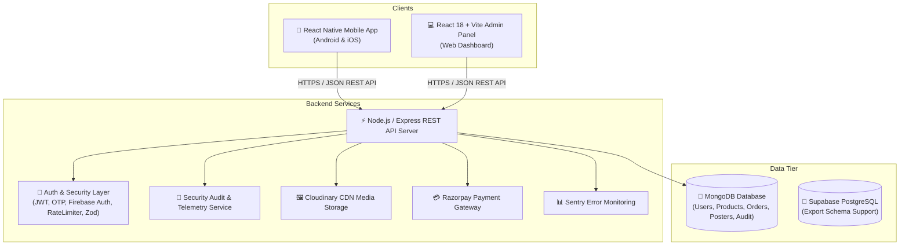
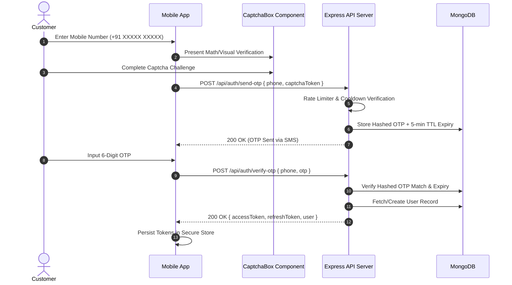

# Tech Crate Technical Architecture

This document provides a comprehensive overview of the technical architecture, component relationships, data flow, and design patterns implemented in **Tech Crate (TechCrate)**.

---

## 🏗️ High-Level System Architecture

Tech Crate follows a 3-tier decoupling architecture separating client presentation, RESTful business logic, and persistent storage.

---

## 📱 Client Layer Architecture

### 1. React Native Mobile App (`mobile/`)
- **State Management**: **Zustand** stores (`authStore`, `productStore`, `cartStore`, `posterStore`, `wishlistStore`, `projectStore`).
- **Navigation**: **React Navigation 6** stack navigator split into `CustomerNavigator`, `AdminNavigator`, and `SellerNavigator`.
- **UI & Styling**: Custom design token system (`theme/colors.js`), native vector icons, and custom components (`CaptchaBox`, `PosterCarousel`, `SafeImage`).
- **Authentication Services**: `authService.js`, `firebaseAuthService.js`, and `socialAuthService.js`.

### 2. Admin Web Control Panel (`admin/`)
- **Framework**: **React 18** bundled with **Vite** for fast HMR.
- **Styling**: Tailwind CSS + custom UI widgets.
- **State Management**: Zustand stores (`adminAuthStore.js`, `authStore.js`).
- **API Interceptors**: Axios client with JWT bearer token auto-injection and refresh token handling.

---

## ⚡ Backend REST API Layer (`backend/`)

- **Server Runtime**: Express.js on Node.js v18/v20.
- **Security & Middleware**:
  - `helmet`: HTTP headers security.
  - `express-mongo-sanitize`: NoSQL injection defense.
  - `xss-clean`: Input HTML sanitization.
  - `rateLimiter.js`: Express rate limiting per route.
  - `zodValidation.js`: Payload schema validation.
  - `authMiddleware.js`: JWT token verification and role-based access authorization (`admin`, `seller`, `customer`).
- **Observability**: Sentry SDK initialization (`config/sentry.js`) and audit logger (`services/auditService.js`).

---

## 🍃 Data Tier Architecture

- **Primary Storage**: MongoDB with Mongoose ODM models:
  - `User.js`, `Product.js`, `Order.js`, `Poster.js`, `Category.js`, `Coupon.js`, `ProjectKit.js`, `Cart.js`, `Wishlist.js`, `OtpChallenge.js`, `RefreshToken.js`, `AuditLog.js`, `SecurityLog.js`, `Seller.js`.
- **Relational Export**: `backend/database/supabase_schema.sql` provides relational tables, indexes, triggers, and foreign keys for PostgreSQL / Supabase migration.

---

## 🔄 Sequence Diagrams

### 1. Mobile OTP Authentication Flow

---

## 🛡️ Security Isolation Decisions

1. **Admin Portal Isolation**: `POST /api/auth/login` is the sole entry point for administrator sessions. The customer OTP endpoint explicitly blocks privilege escalation to the `admin` role.
2. **Immutable Audit Trails**: Security-sensitive mutations (role promotion, seller rejection, token revocation) emit logs to `AuditLog` that cannot be edited or erased via API endpoints.
