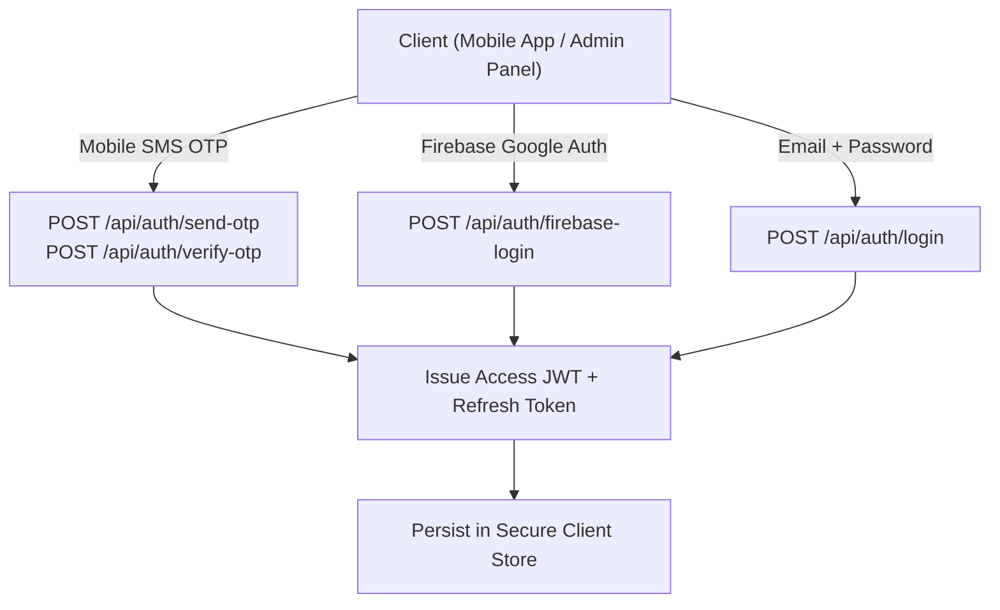

# Authentication & Security System Documentation

This document describes the multi-channel authentication mechanisms, token lifecycles, and security safeguards in **Tech Crate**.

---

## 🔑 Authentication Mechanisms

---

## 1. Passwordless SMS OTP Auth Flow (`otpAuthController.js`)
1. Client requests OTP via `POST /api/auth/send-otp` with mobile number.
2. `otpLimiter` enforces 30-second cooldown per phone number.
3. Express server generates cryptographic 6-digit numeric OTP.
4. SHA-256 hash of OTP stored in MongoDB `OtpChallenge` model with 5-minute TTL auto-expiring index.
5. Verification via `POST /api/auth/verify-otp` matches incoming hash against DB record and issues JWT tokens upon success.

---

## 2. Firebase & Social Auth (`firebaseAuthController.js`)
1. Mobile user signs in natively via `@react-native-google-signin/google-signin`.
2. Mobile app sends ID token to `POST /api/auth/firebase-login`.
3. Firebase Admin SDK verifies ID token signature server-side.
4. User profile synchronized in MongoDB, issuing standard Tech Crate JWT session.

---

## 3. Strict Admin Portal Isolation
- Standard login route (`POST /api/auth/login`) is required for admin role access.
- Role checks enforced via `authorizeRoles('admin')` middleware.
- Privilege escalation from customer OTP auth to `admin` role is blocked at controller level.

---

## 🔐 Token Lifecycle & Refresh Strategy

| Token Type | Expiration | Storage Location | Payload Contents |
| :--- | :--- | :--- | :--- |
| **Access Token (JWT)** | 30 Days (Configurable) | AsyncStore / Memory | `userId`, `role` |
| **Refresh Token** | 90 Days | MongoDB `RefreshToken` | `userId`, `tokenHash`, `deviceId` |

Revocation of all active user sessions can be triggered via `POST /api/auth/security/sessions/revoke-all`.
