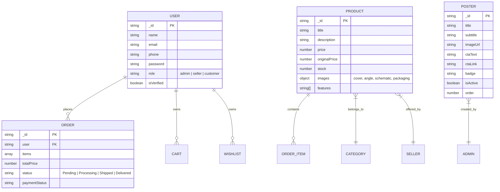

# Database Documentation & Schemas

This document describes the database storage layer, MongoDB Mongoose ODM models, indexing strategies, and the relational PostgreSQL / Supabase SQL schema.

---

## 🍃 MongoDB Mongoose Collections



---

## 📋 Core Schemas Detail

### 1. Product Schema (`models/Product.js`)
```javascript
{
  title: { type: String, required: true, trim: true },
  description: { type: String, required: true },
  category: { type: String, required: true, index: true },
  price: { type: Number, required: true },
  originalPrice: { type: Number },
  discountedPrice: { type: Number },
  stock: { type: Number, required: true, default: 0 },
  images: {
    cover: { type: String, required: true },
    angle: { type: String },
    schematic: { type: String },
    packaging: { type: String }
  },
  features: [{ type: String }],
  seller: { type: mongoose.Schema.Types.ObjectId, ref: 'User' }
}
```

### 2. Promotional Poster Schema (`models/Poster.js`)
```javascript
{
  title: { type: String, required: true },
  subtitle: { type: String },
  imageUrl: { type: String, required: true },
  ctaText: { type: String, default: 'Explore Now' },
  ctaLink: { type: String, default: '/products' },
  badge: { type: String },
  isActive: { type: Boolean, default: true, index: true },
  order: { type: Number, default: 0 }
}
```

### 3. Security Audit Log Schema (`models/AuditLog.js`)
```javascript
{
  action: { type: String, required: true, index: true },
  performedBy: { type: mongoose.Schema.Types.ObjectId, ref: 'User' },
  targetResource: { type: String },
  ipAddress: { type: String },
  details: { type: Object },
  createdAt: { type: Date, default: Date.now, expires: '90d' }
}
```

---

## 🐘 Supabase / PostgreSQL Relational Export (`backend/database/supabase_schema.sql`)

For deployments utilizing Supabase or PostgreSQL, the repository includes DDL definitions for relational tables:

```sql
CREATE TABLE users (
    id UUID PRIMARY KEY DEFAULT gen_random_uuid(),
    name VARCHAR(255) NOT NULL,
    email VARCHAR(255) UNIQUE,
    phone VARCHAR(20) UNIQUE,
    role VARCHAR(20) DEFAULT 'customer',
    created_at TIMESTAMP WITH TIME ZONE DEFAULT NOW()
);

CREATE TABLE products (
    id UUID PRIMARY KEY DEFAULT gen_random_uuid(),
    title VARCHAR(255) NOT NULL,
    description TEXT,
    price NUMERIC(10, 2) NOT NULL,
    original_price NUMERIC(10, 2),
    stock INT DEFAULT 0,
    cover_image TEXT,
    angle_image TEXT,
    schematic_image TEXT,
    packaging_image TEXT,
    created_at TIMESTAMP WITH TIME ZONE DEFAULT NOW()
);
```
