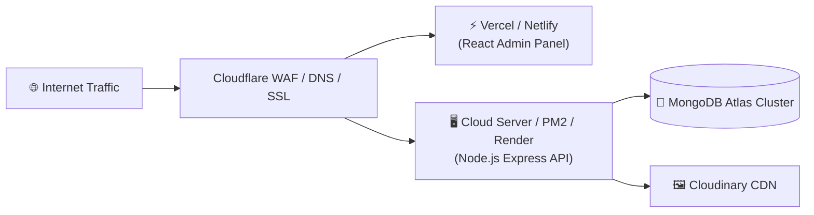

# Production Deployment Guide

This document outlines deployment architectures, environment configuration, SSL setup, and process management for **Tech Crate**.

---

## 🚀 Deployment Overview



---

## 1. Backend API Deployment (PM2 / Linux VPS)

### Environment Setup:
```bash
sudo apt update && sudo apt install -y nodejs npm git
sudo npm install -g pm2
```

### Build & Process Startup:
```bash
cd /var/www/techcrate/backend
npm install --production

# Start Express server with PM2 process manager
pm2 start server.js --name "techcrate-api" --env production
pm2 save
pm2 startup
```

---

## 2. Admin Web Panel Deployment (Vite / Vercel / Nginx)

### Build Static Assets:
```bash
cd admin
npm run build
```
Output static assets land in `admin/dist`.

### Nginx Configuration Example (`/etc/nginx/sites-available/techcrate-admin`):
```nginx
server {
    listen 80;
    server_name admin.techcrate.com;

    root /var/www/techcrate/admin/dist;
    index index.html;

    location / {
        try_files $uri $uri/ /index.html;
    }
}
```

---

## 3. Mobile Application Release Builds

### Android APK / AAB Generation:
```bash
cd mobile/android
./gradlew assembleRelease
# Output: mobile/android/app/build/outputs/apk/release/app-release.apk
```

---

## 📊 Monitoring & Telemetry

- **Error Monitoring**: Sentry initialized via `config/sentry.js`. Set `SENTRY_DSN` in environment variables.
- **Process Health**: `pm2 status` and `pm2 logs techcrate-api`.
