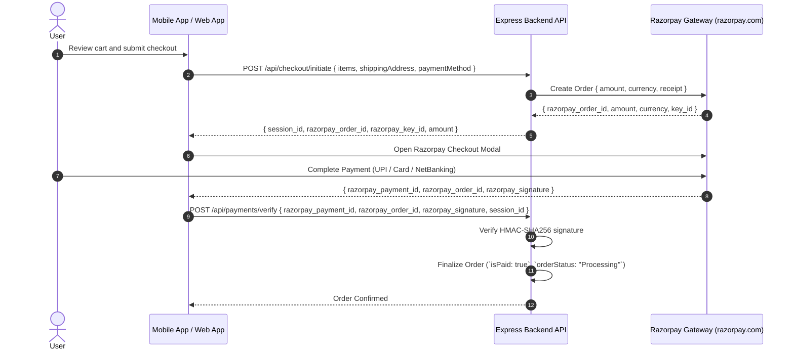

# Payment Gateway & Order Lifecycle Feature Specification

This document details payment processing with **Razorpay** (`https://razorpay.com`), cart/wishlist management, and order status transitions.

---

## 💳 Razorpay Payment Gateway Integration (`controllers/paymentController.js` & `services/razorpayService.js`)

TechCrate utilizes **Razorpay** (`https://razorpay.com`) for secure, seamless checkout supporting UPI, Credit/Debit Cards, NetBanking, and Wallets.



---

## ⚙️ Environment Configuration

Set up the following variables in your `backend/.env` file:

```env
# Razorpay Payment Gateway
RAZORPAY_KEY_ID=rzp_test_your_key_id_here
RAZORPAY_KEY_SECRET=your_razorpay_key_secret_here
RAZORPAY_WEBHOOK_SECRET=your_razorpay_webhook_secret_here
```

In development environments where keys are unset or using placeholders, the system uses a built-in sandbox mock mode for offline testing.

---

## 📦 Order Status Lifecycle

Orders progress through defined state transitions:
1. `Pending`: Order created, awaiting payment confirmation.
2. `Processing`: Payment verified via Auto UPI Gateway; order routed to fulfillment team.
3. `Shipped`: Dispatch tracking code assigned.
4. `Delivered`: Successful delivery to customer shipping address.
5. `Cancelled`: Order voided prior to dispatch.
