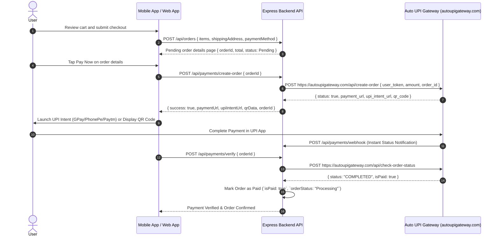

# Payment Gateway & Order Lifecycle Feature Specification

This document details payment processing with **Auto UPI Gateway** (`https://autoupigateway.com`), cart/wishlist management, and order status transitions.

---

## 💳 Auto UPI Payment Gateway Integration (`controllers/paymentController.js` & `services/autoUpiService.js`)

TechCrate utilizes **Auto UPI Gateway** (`https://autoupigateway.com`) for direct, instant UPI transactions, intent links, QR codes, and automated webhooks.



---

## ⚙️ Environment Configuration

Set up the following variables in your `.env` file:

```env
# Auto UPI Gateway (https://autoupigateway.com)
AUTO_UPI_GATEWAY_URL=https://autoupigateway.com
AUTO_UPI_USER_TOKEN=your_merchant_user_token_here
AUTO_UPI_WEBHOOK_SECRET=your_webhook_secret_here
```

In development or staging environments where `AUTO_UPI_USER_TOKEN` is unset, the system seamlessly uses a built-in sandbox mock mode for offline testing.

---

## 📦 Order Status Lifecycle

Orders progress through defined state transitions:
1. `Pending`: Order created, awaiting payment confirmation.
2. `Processing`: Payment verified via Auto UPI Gateway; order routed to fulfillment team.
3. `Shipped`: Dispatch tracking code assigned.
4. `Delivered`: Successful delivery to customer shipping address.
5. `Cancelled`: Order voided prior to dispatch.
